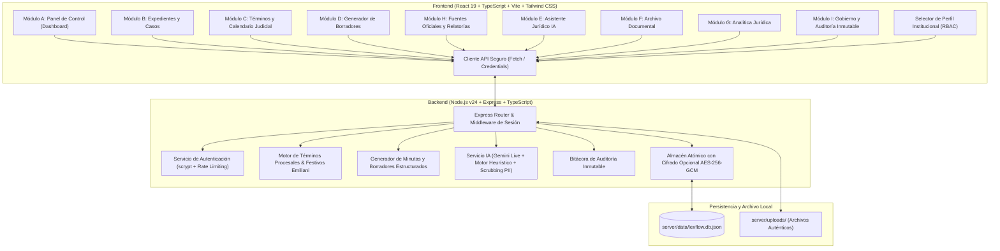

# LexFlow Colombia ⚖️🇨🇴 (Versión 2.0.0)
### Plataforma Inteligente de Gestión Jurídica para Consultorios Jurídicos Universitarios, Abogados Independientes y Equipos Legales

---

## 1. Visión General del Producto

**LexFlow Colombia** es una plataforma web integral diseñada para el contexto procesal y sustancial colombiano, armonizada con el régimen legal de los **Consultorios Jurídicos Universitarios (Ley 2113 de 2021)**, la **Ley Estatutaria de Protección de Datos Personales / Habeas Data (Ley 1581 de 2012)** y la justicia digital (Ley 2213 de 2022).

La aplicación opera bajo principios éticos y técnicos de **diferenciación rigurosa**:
1. **Diferenciación de fuentes**: Separa con claridad meridiana los **datos fácticos ingresados por el usuario**, las **normas jurídicas verificadas** y el **contenido preliminar generado por inteligencia artificial**.
2. **Cómputo procesal prudente**: Distingue conceptual y operativamente entre un **contador matemático de días calendario** y un **término procesal hábil jurídicamente verificado** (CGP Art. 118, CPACA Art. 119, Ley 2213 de 2022, Ley Emiliani). Si no hay constancia de notificación, se cataloga como `Pendiente de verificación jurídica`.
3. **Control de acceso basado en roles (RBAC)**: Respeta las competencias delimitadas de estudiantes en práctica, docentes supervisores, dirección y recepción según la Ley 2113 de 2021.
4. **Minimización de datos (PII)**: Anonimiza números de cédula, NIT, teléfonos, direcciones físicas y correos electrónicos antes de invocar modelos de lenguaje externos.
5. **Responsabilidad profesional**: Todo borrador incluye advertencias visibles: *no sustituye el juicio ni la firma del abogado o docente titular*.

---

## 2. Arquitectura del Sistema



---

## 3. Módulos del Sistema

### Módulo A. Panel de Control (Dashboard)
- Indicadores en tiempo real derivados de los registros: Total de expedientes, activos, en trámite, para fallo en despacho, suspendidos y cerrados.
- Contador de **Términos Críticos** (vencidos o con vencimiento en &le; 3 días).
- Banner de alerta visual prominente ante vencimientos inminentes.
- Gráficos interactivos de distribución de casos por Rama del Derecho (Laboral, Civil, Penal, Administrativo, Constitucional, Familia, Comercial).
- Carga de trabajo en tiempo real por cada abogado o estudiante de consultorio.
- Gráfico de evolución procesal semestral (radicaciones vs. cierres).
- Botón directo para marcar actuaciones como cumplidas con 1 clic.

### Módulo B. Gestión de Casos Jurídicos
- Ficha completa de expediente: Radicado único, Rama, Tipo de procedimiento, Hechos, Pretensiones, Partes procesales completas (Demandante vs. Demandado con Cédula/NIT, rol y canal de notificación), Despacho judicial, Estado, Fechas de apertura y vencimiento, Responsable, Cuantía estimada y condición Pro-Bono.
- **Consentimiento Habeas Data (Ley 1581 de 2012)** y bandera de secreto profesional estricto.
- **Filtro RBAC**: Los estudiantes en práctica visualizan únicamente los expedientes a su cargo, mientras que supervisores y directores tienen vista integral.
- **Modal de Detalle Procesal (`CaseDetailModal`)** con 3 pestañas: Resumen fáctico/pretensiones, Historial de actuaciones y Archivo documental anexo.
- Creación y edición con validación de campos obligatorios.
- Modal de confirmación antes de eliminar con borrado en cascada seguro.

### Módulo C. Control de Términos y Calendario Procesal
- Vista dual: **Lista de Actuaciones Prioritarias** y **Calendario Mensual Interactivo**.
- Tipología de actuaciones: Audiencias, Vencimientos de término, Radicaciones de memoriales, Entrega de documentos/subsanaciones, Reuniones y Recordatorios.
- **Diferenciación Jurídica Fundamental**:
  - Distingue entre **Días Calendario Corridos** y **Término Procesal Hábil**.
  - Si no se cuenta con la constancia de notificación electrónica (Ley 2213/2022) o ejecutoria del auto, el sistema etiqueta la actuación como:  
    `⚠️ Pendiente de verificación jurídica`  
    acompañada de la nota explicativa técnica correspondiente (CGP Art. 118 / CPACA Art. 119 / Ley 1755 / Dec. 2591).
- Contador de días restantes (`Vencido hace X días`, `Vence HOY`, `X días restantes`).
- Guía interactiva de términos procesales colombianos integrada.
- Acción de marcar actuación como revisada/cumplida.

### Módulo D. Generador de Documentos Jurídicos
Asistente estructurado para 7 tipos de minutas:
1. **Derecho de Petición** (Art. 23 C.P. & Ley 1755 de 2015).
2. **Acción de Tutela** (Art. 86 C.P. & Decreto 2591 de 1991).
3. **Solicitud de Conciliación Extrajudicial en Derecho** (Ley 2220 de 2022).
4. **Memorial de Impulso Procesal y Celeridad** (CGP / CPACA).
5. **Solicitud de Información Pública y Documentos** (Ley 1712 de 2014).
6. **Comunicación / Descargos a Entidad Pública**.
7. **Lista de Verificación Documental para Radicación Judicial** (Ley 2213 de 2022).

- Estructura formal completa: Encabezado, Destinatario, Identificación de comparecientes, Hechos numerados, Fundamentos jurídicos fundamentados, Peticiones, Juramento tutelar, Relación de pruebas, Notificaciones Ley 2213 y espacio de suscripción.
- Exportación editable, copia al portapapeles, descarga `.txt` e impresión limpia.

### Módulo E. Asistente Jurídico con IA (LexFlow Copilot)
- **Minimización previa de PII**: Cédulas, NITs, teléfonos, correos y direcciones son suplantados por marcadores de posición (`[DOC_IDENTIDAD_PROTEGIDO]`, `[CORREO_PROTEGIDO]`, etc.) antes del procesamiento del modelo.
- **Analizador Estructurado de Hechos**:
  - Línea de tiempo cronológica de hitos fácticos.
  - Hechos pendientes de prueba o aclaración.
  - Checklist documental estructurado (Obligatorio, Recomendable, Opcional).
  - Cuestionario de entrevista inicial.
  - Áreas del Derecho comprometidas con sustentación.
  - Lista preliminar de actuaciones procesales secuenciales.
  - Matriz de riesgos procesales e incertidumbres jurídicas.
  - Resumen ejecutivo formal.
- **Chat Copilot**: Consultas procesales con transparencia entre Gemini Live y el Motor Heurístico Colombiano local.

### Módulo F. Gestión Documental
- Asociación de archivos a expedientes específicos.
- Metadatos: Título, Tipo documental, Fecha de incorporación, Tamaño, Formato MIME y Estado de cotejo (`Pendiente de Cotejo`, `Cotejado y Aprobado`, `Con Observaciones`).
- Validación en cliente y servidor: Límite de 10 MB, lista blanca de extensiones seguras (PDF, DOCX, TXT, PNG, JPG).
- Almacenamiento seguro en backend (`uploads/`) con nombres aleatorizados para mitigar *Path Traversal*.

### Módulo G. Analítica Jurídica
- Métricas calculadas dinámicamente con registros reales:
  - Tasa de resolución (casos cerrados vs. total).
  - Tasa de efectividad en cumplimiento de términos.
  - Cuantía total estimada en litigio ($ COP).
  - Porcentaje de litigio Pro-Bono.
  - Balance de carga y productividad por responsable.
  - Impresión de informe ejecutivo.

### Módulo H. Repositorio de Fuentes Oficiales y Relatorías
- Catálogo oficial con enlaces HTTPS hacia los repositorios judiciales de Colombia:
  - **SUIN-JURISCOL / MinJusticia** (Leyes, decretos y normas vigentes).
  - **Relatoría de la Corte Constitucional** (Sentencias de Tutela, Constitucionalidad y Unificación).
  - **Relatoría de la Corte Suprema de Justicia** (Casación Laboral, Civil y Penal).
  - **SAMAI / Consejo de Estado** (Jurisprudencia de lo Contencioso Administrativo).
  - **Estatutos procesales clave**: CGP, CPACA, Ley 2213 de 2022, Ley 2113 de 2021.
- Registro de nuevas fuentes con validación estricta HTTPS y notas de vigencia.
- **Convalidación por Supervisión**: Las fuentes ingresan como *Pendiente de Cotejo* y deben ser convalidadas por un Docente Supervisor o Director.

### Módulo I. Gobernanza Institucional y Bitácora de Auditoría
- Matriz de fases y estado de integraciones externas (SUIN-JURISCOL, Relatorías Altas Cortes, Gemini Live / Heurístico Local, Convenios SSO).
- **Bitácora de Auditoría Inmutable**: Registro criptográfico y cronológico de todas las acciones del sistema (Login, creación y edición de casos, cambios de término, convalidación de fuentes, cotejo de documentos).
- Estado de protección de datos personales y cifrado en reposo (AES-256-GCM).

---

## 4. Control de Acceso y Perfiles (RBAC)

El sistema incluye 4 perfiles institucionales precargados para demostración y evaluación (contraseña unificada demo: `Demo123!`):

| Rol | Usuario Demo | Correo | Alcance de Competencias |
|---|---|---|---|
| **Directora de Consultorio** | Dra. Camila Restrepo | `coordinacion@demo.local` | Supervisión general, auditoría global, gobernanza y administración institucional. |
| **Docente Supervisor** | Dr. Andrés Gómez | `supervision@demo.local` | Revisión y aprobación de expedientes, convalidación de fuentes oficiales y control de términos. |
| **Estudiante en Práctica** | Valeria Morales | `estudiante@demo.local` | Acceso restringido a sus casos asignados, registro de actuaciones y memoriales bajo tutela docente. |
| **Recepción y Admisión** | Felipe Hernández | `recepcion@demo.local` | Ingreso inicial de usuarios, captura de hechos y registro del consentimiento de Habeas Data. |

---

## 5. Pruebas Automatizadas y Verificación

### 1. Pruebas Unitarias de Lógica Jurídica y RBAC (Vitest)
```powershell
cd lexflow-colombia/server
npm test
```
**Resultado:**
```text
 ✓ src/tests/legalTests.test.ts (12 tests)
   - Festivos y fines de semana colombianos (Ley Emiliani)
   - Cómputo de términos procesales y advertencias legales
   - Minuta técnica de Acción de Tutela (Dec. 2591 de 1991)
   - Hash y verificación de claves con scrypt
   - Control de rate limiting en login
   - Generación de sesiones criptográficas con CSRF
   - Anonimización y minimización de PII (Ley 1581 de 2012)
   - Datos semilla y métricas derivadas
   - Restricción de alcance para rol STUDENT
   - Registro y convalidación docente de fuentes oficiales
   - Bitácora de auditoría inmutable
   - Asistente heurístico de análisis de hechos fácticos
 Test Files  1 passed (1)
 Tests       12 passed (12)
```

### 2. Pruebas Funcionales End-to-End (`e2e-api.mjs`)
```powershell
node lexflow-colombia/tests/e2e-api.mjs
```
**Resultado:**
```text
--- INICIANDO PRUEBAS FUNCIONALES E2E LEXFLOW COLOMBIA ---
✅ [PASÓ] 1. Health check responde con salvaguardas y motor de IA
✅ [PASÓ] 2. Endpoint de Gobernanza e Integraciones Institucionales (/api/governance)
✅ [PASÓ] 3. Autenticación con scrypt para Docente Supervisor (/api/auth/login)
✅ [PASÓ] 4. Registro y convalidación de fuente oficial con HTTPS (/api/sources)
✅ [PASÓ] 5. Consulta de bitácora de auditoría inmutable (/api/audit)
✅ [PASÓ] 6. Indicadores del Dashboard calculados con precisión (/api/metrics)
✅ [PASÓ] 7. Creación de caso con consentimiento de datos personales (Ley 1581)
✅ [PASÓ] 8. Verificación de persistencia del caso creado
✅ [PASÓ] 9. Registro de actuación y cómputo de términos con reglas hábiles
✅ [PASÓ] 10. Toggle de actuación completada / cumplida
✅ [PASÓ] 11. Generación de borrador de Derecho de Petición (Ley 1755 / Art. 23 CP)
✅ [PASÓ] 12. Asistente de IA con minimización automática de PII (Ley 1581)
✅ [PASÓ] 13. Eliminación del caso de prueba y limpieza en cascada
✅ [PASÓ] 14. Servidor web entrega la interfaz SPA de LexFlow en la raíz

====================================================
RESULTADO FINAL DE PRUEBAS E2E: 14 / 14 PRUEBAS PASADAS
====================================================
```

---

## 6. Puesta en Marcha

1. **Construir el cliente y servidor**:
   ```powershell
   cmd.exe /c "cd lexflow-colombia\client && npm run build"
   cmd.exe /c "cd lexflow-colombia\server && npm run build"
   ```
2. **Iniciar el servidor unificado**:
   ```powershell
   cmd.exe /c "cd lexflow-colombia\server && npm start"
   ```
3. **Acceder a la plataforma**:
   Navegar a: `http://localhost:3001`
   - La aplicación inicia automáticamente en modo demostrativo con todos los datos institucionales precargados.
   - Puede alternar roles o iniciar sesión haciendo clic sobre la insignia de usuario en la esquina superior derecha o en la barra lateral.
